<div align="center">

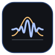

# Physics Feed

**Every new physics paper and science story that matters to *you*, in one calm app.**
arXiv + ~90 journals + news, sorted into your research topics, every day. For Linux and Android.

[](https://github.com/knight-dwell/physics-feed/releases/latest)


[**Download for Android**](https://github.com/knight-dwell/physics-feed/releases/latest) ·
[**Install on Linux**](#-install-on-linux) ·
[**User guide**](#-how-to-use-it) ·
[**FAQ**](#-faq)

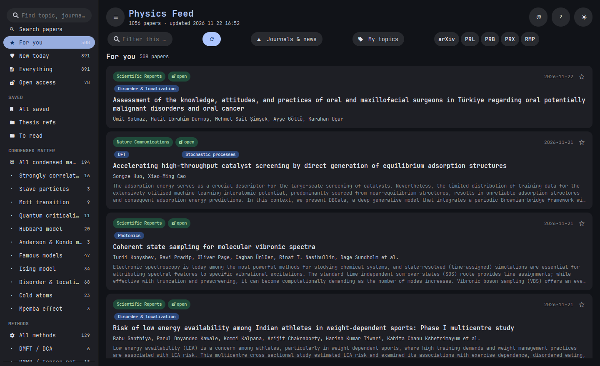

</div>

---

## Why Physics Feed?

Keeping up with the literature means checking arXiv every morning, then PRL, PRB, Nature Physics, J. Phys. A, your
own niche journals… and still missing the one paper that matters. Physics Feed does the checking for you:

- 🧲 **One feed for everything** — arXiv and ~90 journals (all APS journals, the Nature family, Science, PNAS, IOP,
  AIP, Springer, Elsevier, Optica, ACS, Wiley, SciPost, Quantum, and Indian journals such as Pramana, Current Science
  and Resonance), plus science news.
- 🏷️ **Sorted into *your* topics** — strongly correlated systems, topology, DMFT, slave bosons, stat mech, photonics…
  every paper is tagged by keywords you choose, so "For you" shows only what you care about.
- 📖 **Read without leaving** — full abstracts, PDFs and open-access papers open right in the app; journal pages open
  there too (your institute's access works).
- 🔎 **Search all of arXiv and all journals** — by words, author, arXiv ID / DOI, category and topic; Google Scholar
  one tap away.
- 📚 **Cite, share, save** — BibTeX / RIS in one click, share to WhatsApp / Telegram / email, save papers into folders
  with your own `#flair` tags.
- 📰 **News too** — ML & AI (Google, DeepMind, OpenAI, Hugging Face…), physics news (APS Physics, Physics World,
  Quanta…), Indian science news and PIB/DST press releases, kept separate from papers.
- 🔒 **No account, no tracking, free and open source.** It only talks to arXiv, Crossref and the feeds you choose.

---

## 📸 A quick tour

### Desktop (Linux)

| Your feed, sorted into topics | Full abstract, cite, share, save |
|---|---|
|  | 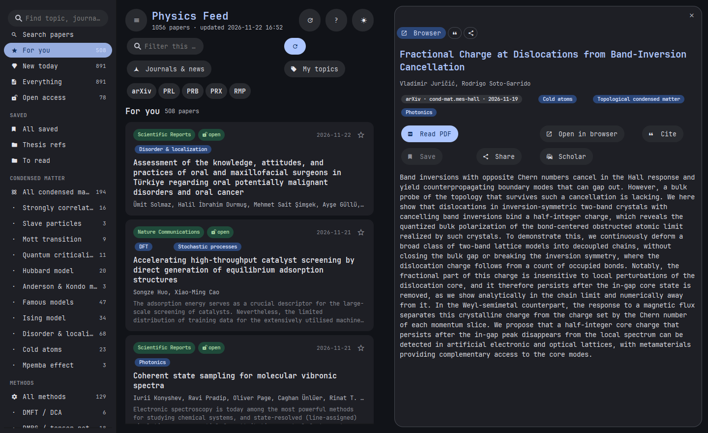 |
| **Read the PDF inside the app** | **Search all of arXiv / all journals** |
| 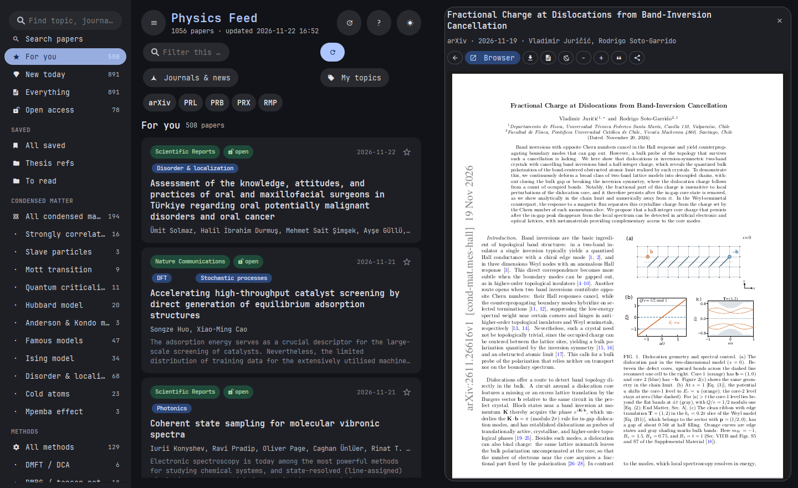 | 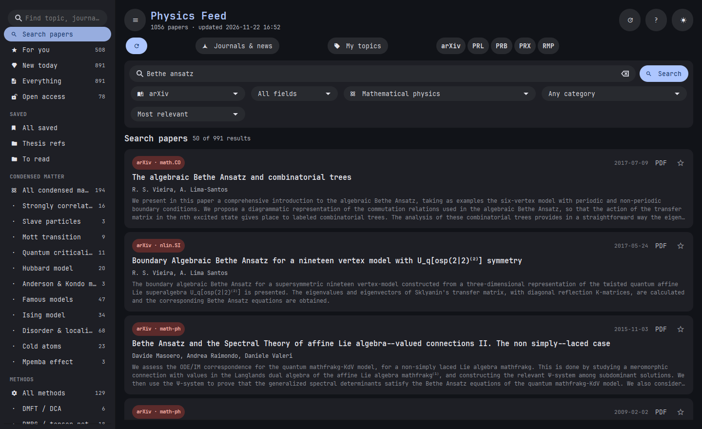 |
| **News with pictures** | **Saved papers in folders, with your flairs** |
| 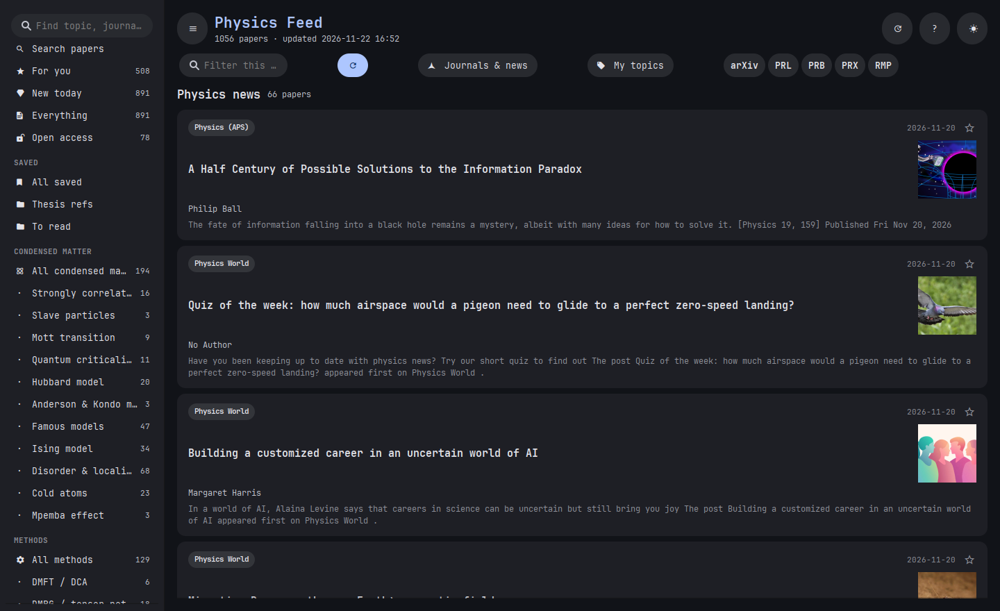 | 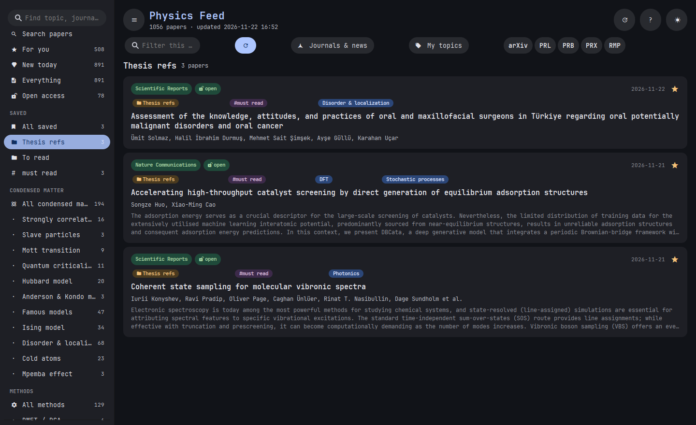 |
| **Light mode** | **Pick journals & news (or add your own)** |
| 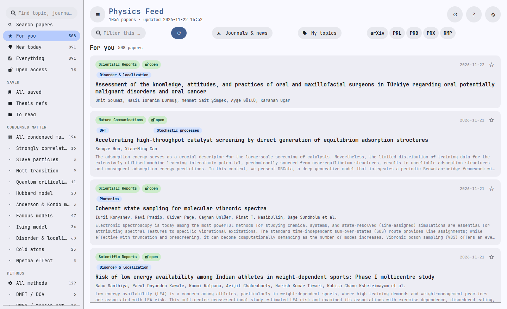 | 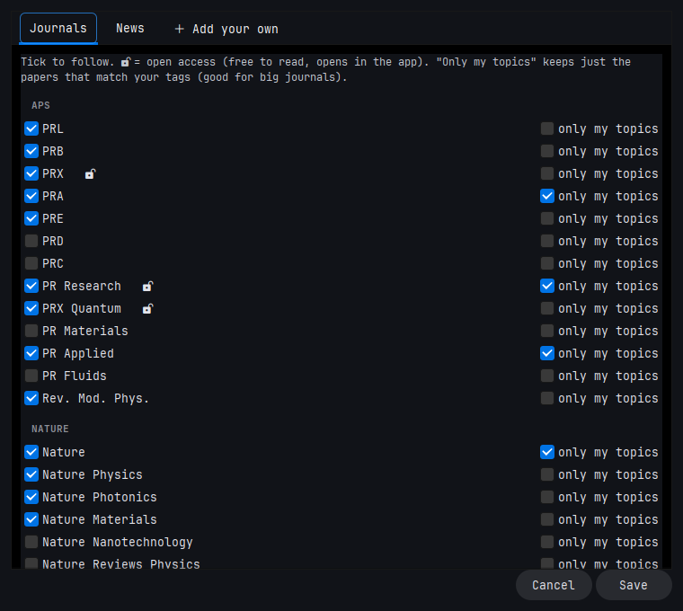 |
| **Add a research field and tick its tags** | **Built-in updates** |
| 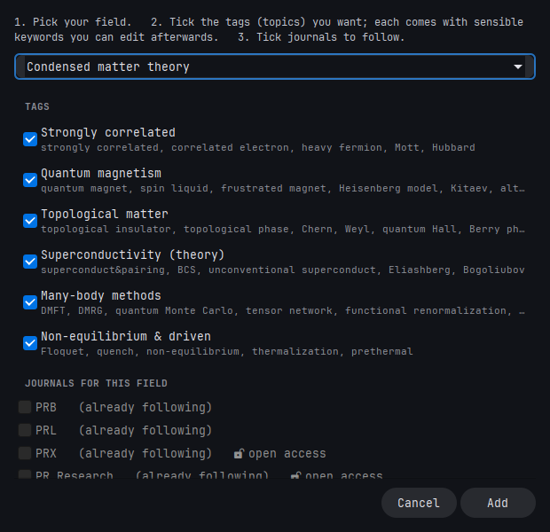 | 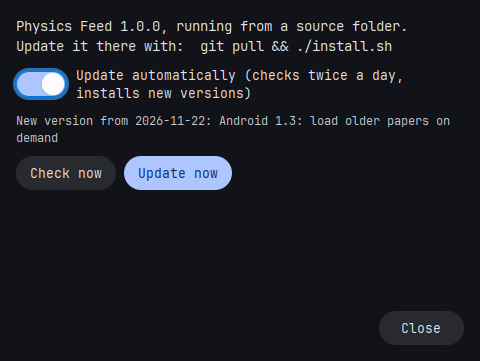 |

### Android

| Welcome: pick your fields | Swipe through papers | Swipe through news | A paper |
|---|---|---|---|
| 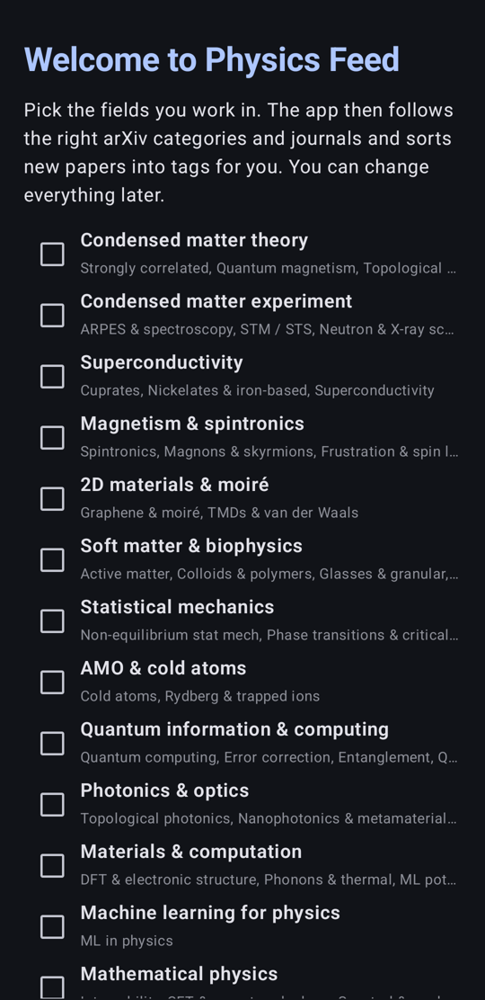 | 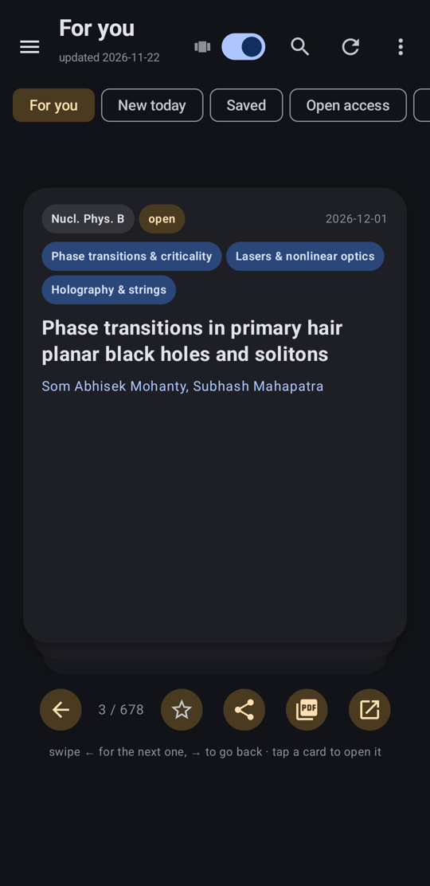 | 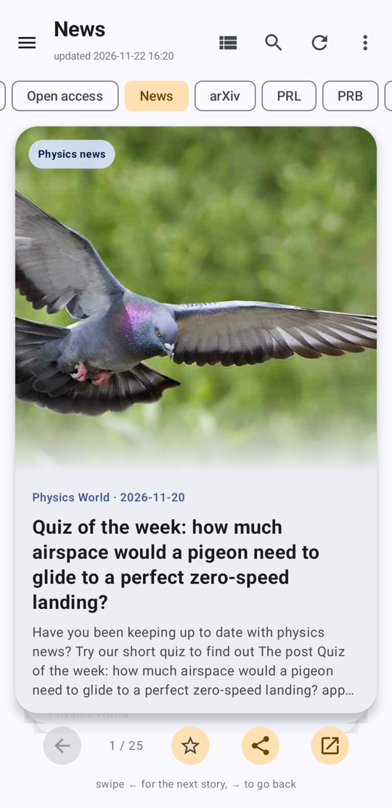 | 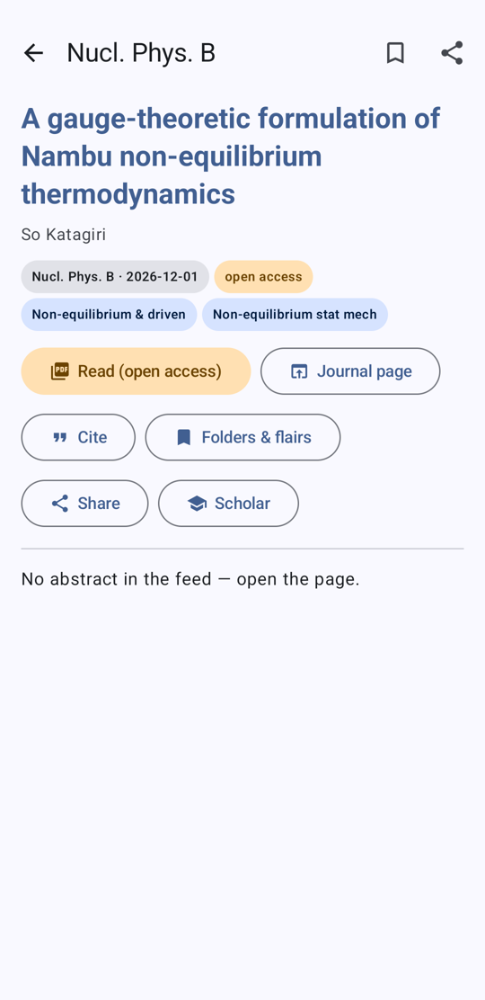 |

---

## 📱 Install on Android

1. On your phone, open the [**latest release**](https://github.com/knight-dwell/physics-feed/releases/latest) and
   download **`physics-feed.apk`**.
2. Open the downloaded file. Android asks to *allow installing apps from this source* (your browser or Files app) —
   allow it, then tap **Install**.
3. Open **Physics Feed**, tick your research field(s), tap **Start**. Papers arrive within a minute.

Android 8 or newer. The app updates itself: **⋮ → Updates** (with *Update automatically* on, it downloads new
versions and Android asks you to confirm).

## 💻 Install on Linux

```bash
git clone https://github.com/knight-dwell/physics-feed.git
cd physics-feed
./install.sh
```

The installer works on **Ubuntu / Debian / Mint / Pop!_OS, Fedora / RHEL, Arch / Manjaro / EndeavourOS, openSUSE,
Alpine and Void**. It installs the few system packages it needs (Python + GTK, plus the optional PDF and web viewers;
asks for your password once), installs the app for your user only, adds it to your app menu and fetches new papers
twice a day. At the end it tells you how to open it:

- from the app menu: **Physics Feed**
- or in a terminal: **`pfeed`**

| Command | What it does |
|---|---|
| `pfeed` | open the app |
| `pfeed --refresh` | fetch new papers now |
| `pfeed --help` | all options |
| `./install.sh --no-deps` | install without touching system packages |
| `./uninstall.sh` | remove it (`--purge` also deletes your settings and saved papers) |

The desktop app updates itself too: the **⇪** button in the top bar (with *Update automatically* on, it installs new
versions by itself). Or `git pull && ./install.sh` in the folder.

---

## 🧭 How to use it

### First start
A welcome screen asks which fields you work in (condensed matter theory or experiment, superconductivity, magnetism,
2D materials, soft matter, statistical mechanics, AMO & cold atoms, quantum information, photonics, materials &
computation, ML for physics, mathematical physics, high energy). Physics Feed then follows the right arXiv categories
and journals and creates tags for you. You can change everything later.

### Everyday
| | Desktop | Android |
|---|---|---|
| Sections | sidebar: For you, New today, Saved, Open access, your topics, journals, news | ☰ menu and chips on top; swipe between sections (list mode) |
| Quick journals | arXiv · PRL · PRB · PRX · RMP buttons | the same chips |
| Read a paper | click it → full abstract on the right; click again to close | tap a card → abstract page |
| PDF | **Read PDF** (arXiv) / **Read here** (open access) in the panel | built-in reader (pinch to zoom) or another app (⋮ menu) |
| Cards or list | — | switch in the top bar: swipeable cards ⇄ normal list |
| Cite | **Cite** → BibTeX / RIS: copy, save, add to your `.bib` | **Cite** → copy or send |
| Share | **Share** → link, email, WhatsApp, Telegram, X, Bluesky, LinkedIn | Android's share sheet |
| Save | ☆, then **Save** → folders + your `#flairs` | ☆, then **Folders & flairs** |
| Search | **Search papers**: arXiv / Journals / Scholar, field, *Topic*, category, journal | 🔍 with the same filters, or the ☰ menu's search box |
| Older papers | — | **Load 2 more days** at the end of the list / on the last card |
| Fetch now | ⟳ | pull down, or ⟳ |

### Make it yours
- **My topics → ＋ Add a field…** — pick a field, tick the tags you want. Edit keywords any time: comma separated;
  short ALL-CAPS words (DMFT, SSH) match whole words; `a&b` means both must appear.
- **Journals & news** — tick what to follow. **"Only my topics"** keeps just matching papers (good for big journals
  like Nature or Scientific Reports). **＋ Add your own**: paste a journal's RSS link *or* its ISSN (on the journal's
  "About" page) — the ISSN works for any publisher.
- **Share your setup with your group** — on Android, **⋮ → Export settings** sends a small file; a colleague imports
  it (**⋮ → Import settings**, or on the welcome screen). Desktop settings live in
  `~/.config/physics-feed/config.json` (same format).

---

## ❓ FAQ

**Is it free? Do I need an account?** Free, open source (MIT), no account, no ads, no tracking.

**Which sources does it use?** The arXiv API, publishers' public RSS feeds (APS, Wiley, AIP, …) and **Crossref**
(the official index publishers register their papers with) for journals that don't offer an open feed (IOP,
Springer, Nature, Elsevier, …).

**Can I read paywalled papers?** Physics Feed shows abstracts for everything. Full text opens on the journal's page,
so your institute's subscription works as usual; open-access papers (marked 🔓) open directly.

**Why does a journal show a ↗ link instead of papers?** Its site didn't answer this time; the link opens the journal's
website. **Feed status** (⋮ menu on Android) lists every source and what happened.

**How much data / battery?** A fetch takes a few MB, twice a day (on Android only with internet, through the system's
background scheduler).

**Where is my data?** Only on your device: Linux `~/.config/physics-feed`, `~/.local/share/physics-feed`,
`~/.cache/physics-feed`; Android in the app's private storage.

---

## 🛠 Build it yourself

- Desktop: Python 3 + PyGObject (GTK 3); optional WebKit2GTK and Evince. From the folder: `python3 -m physics_feed`.
- Android: `cd android && ./gradlew assembleRelease` (JDK 17, Android SDK 35). Kotlin + Jetpack Compose.

Ideas and bug reports are welcome in [Issues](https://github.com/knight-dwell/physics-feed/issues).

## License

MIT — use it, share it, change it.
